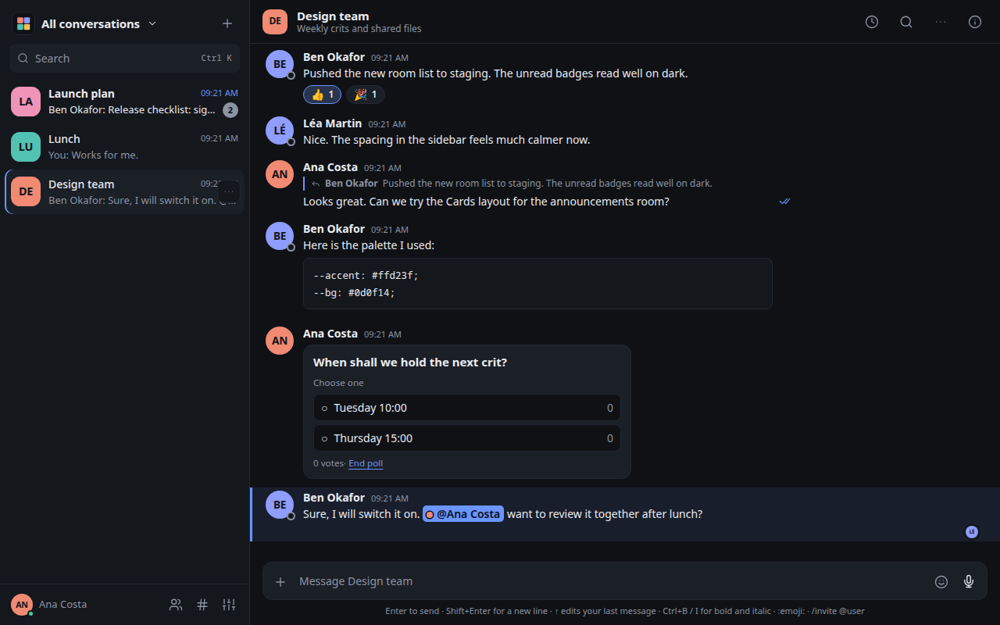
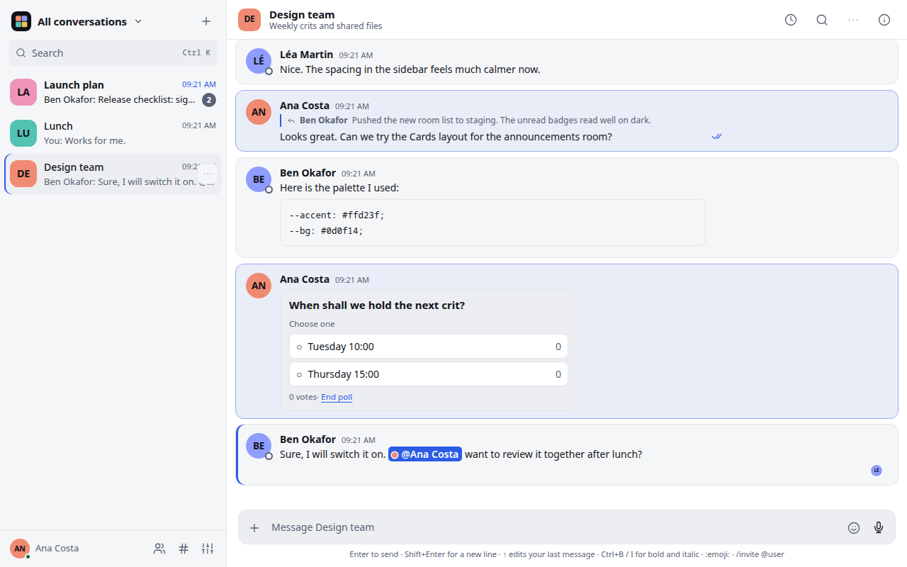
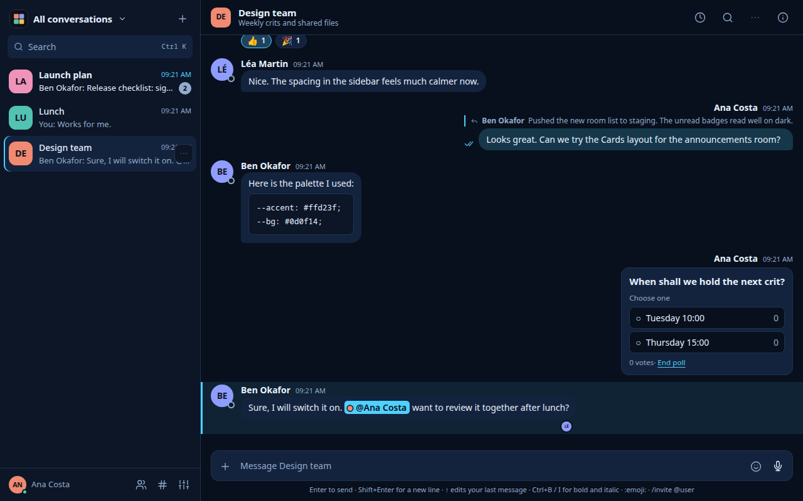
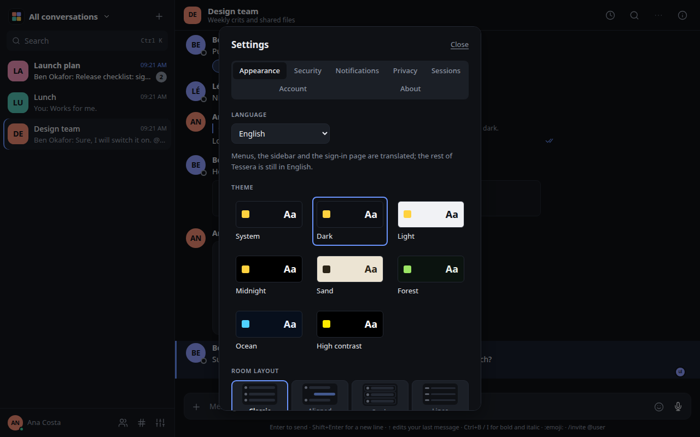
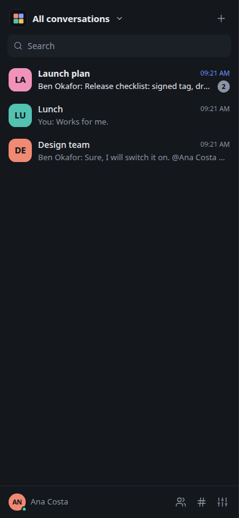
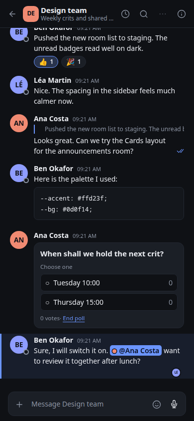

# Screenshots

All of these come from a throwaway Synapse with made-up users.

## Themes and layouts

Eight themes and four room layouts (Classic, Aligned bubbles, Cards and one-line Lines), set in Settings, Appearance. A room can override the default layout.

## On a phone

Tessera installs as a PWA and uses the whole screen on a phone.

| Rooms | A room |
| --- | --- |
|  |  |
